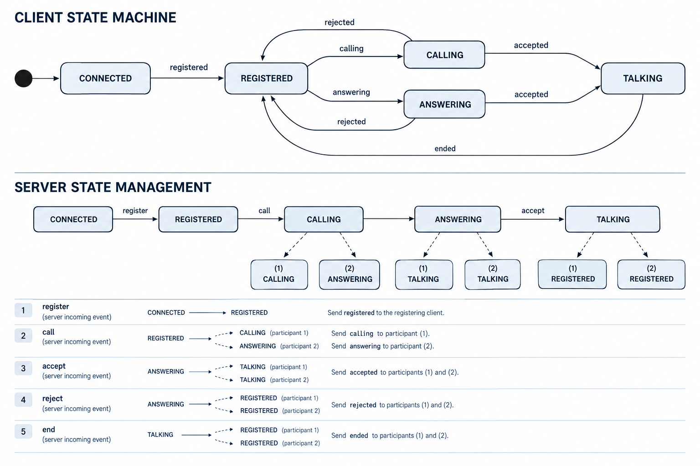

# CallSim

CallSim is a console-based client-server application that simulates phone calls and enables users to exchange text messages during a call.

The project focuses on asynchronous network communication, object-oriented design, state management, and unit testing in C++.

## Features

- Client registration and connection management
- Asynchronous client-server communication
- Text messaging during simulated calls
- Outgoing and incoming call handling
- Accepting and rejecting calls
- Call termination and state restoration
- Busy-user notifications
- Validation of call requests, including attempts to call yourself or an unregistered user
- Reuse of usernames after a client disconnects
- Unit testing and code coverage reporting

**Note:** Calls are simulated. Real audio transmission is not implemented.

## Technologies

- **Language:** C++17
- **Networking:** Boost.Asio
- **Serialization:** Protocol Buffers
- **Build system:** CMake
- **Testing:** GoogleTest, Google Mock
- **Code coverage:** gcovr
- **Environment:** Linux / Ubuntu, GCC, Git

## Architecture

The application consists of two main components: `Client` and `Server`.

For a detailed description of client state transitions and server-side state management, see [STATE_MACHINE.md](STATE_MACHINE.md).



### Client

The client uses an object-oriented state machine to manage its behavior.

- `IState` defines the interface for client states.
- `Connected`, `Registered`, `Calling`, `Answering`, and `Talking` implement state-specific behavior.
- `StateFactory` creates state objects.
- `IConsoleReader` abstracts console input.
- `IRwWrapper` abstracts network communication.

### Server

The server manages connected clients, registrations, and call handling. Client state transitions on the server side are managed using a transition table.

The server also uses an `IRwWrapper` interface to separate network communication from application logic.

### Message protocol

Protocol Buffers are used to serialize messages. Each message is transmitted using a custom length-prefixed format consisting of the message size followed by the serialized message data.

Networking operations are implemented asynchronously using Boost.Asio.

## Project Structure

```text
.
├── Client/
│   ├── inc/        # Client headers, states, interfaces and factories
│   ├── src/        # Client implementation
│   └── test/       # Client unit tests and mocks
├── Server/
│   ├── inc/        # Server headers and interfaces
│   ├── src/        # Server implementation
│   └── test/       # Server unit tests and mocks
├── common/
│   └── ClientStates.hpp
├── proto/
│   └── Message.proto
├── CMakeLists.txt
└── README.md
```

## Getting Started

### Prerequisites

Install the following tools and dependencies:

- CMake
- GCC with C++17 support
- Boost
- Protocol Buffers
- GoogleTest
- gcovr (for code coverage reports)

Ensure that the required libraries and development packages are available in your environment.

### Build

Clone the repository and navigate to the project directory:

```bash
git clone https://github.com/kiborgozavr/callSim.git
cd callSim
```

Configure and build the project:

```bash
cmake -S . -B build
cmake --build build
```

### Run the application

**1. Start the server** in a terminal:

```bash
./build/Server/Server
```

The server listens on port `15001`.

**2. Start the first client** in another terminal:

```bash
./build/Client/Client Alice
```

**3. Start another client** in a separate terminal:

```bash
./build/Client/Client Max
```

You can launch additional clients in separate terminals.

### Example interaction

1. Clients connect to the server and register using their usernames.
2. Alice initiates a call to Max:

   ```text
   call Max
   ```

3. Max receives an incoming call notification and can accept or reject it by entering `yes` or `no`.
4. If Max accepts, both clients enter the chat and can exchange text messages.
5. Either participant can terminate the conversation by entering:

   ```text
   end
   ```

6. Both clients return to the `Registered` state.

If a client attempts to call someone who is already in a call, the server notifies the caller that the recipient is busy. Calls to oneself and to unregistered users are also rejected.

When a client disconnects, its username becomes available for registration by another user.

## Testing

The project includes unit tests for the client and server, implemented using GoogleTest and Google Mock.

Run the test suite with:

```bash
ctest --test-dir build --output-on-failure
```

The tests cover client and server behavior through their respective test suites and mocked dependencies.

## Code Coverage

Code coverage can be enabled through the `ENABLE_COVERAGE` CMake option when using GCC.

Configure and build the project with coverage enabled:

```bash
cmake -S . -B build -DENABLE_COVERAGE=ON
cmake --build build
```

Run the tests:

```bash
ctest --test-dir build --output-on-failure
```

Generate a coverage summary and a detailed HTML report:

```bash
gcovr --root . \
    --filter 'Client/' \
    --filter 'Server/' \
    --html-details build/coverage.html \
    --print-summary
```

The command prints coverage statistics in the terminal and generates an HTML report with detailed source-level coverage information.

Open `build/coverage.html` in a web browser to explore the report.